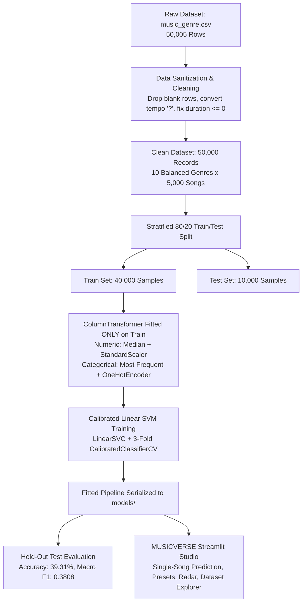

# MUSIC GENRE PREDICTION SYSTEM USING SUPPORT VECTOR MACHINE (SVM)
## A PROJECT REPORT & IMPLEMENTATION REPOSITORY

**Submitted by**
- **Gargi Watts (26BCS10841)**
- **Anjali Singh (26BCS10842)**

*in partial fulfillment for the award of the degree of*  
**BACHELOR OF ENGINEERING IN COMPUTER SCIENCE AND ENGINEERING**  
**Chandigarh University**  
*October 2026*

---


-purple.svg)


---

## BONAFIDE CERTIFICATE

Certified that this project report **"Music Genre Prediction System Using Support Vector Machine"** is the bonafide work of **Anurag Verma (26BCS10805)**, **Ranjeet Kumar (26BCS10859)**, and **Gursimranjeet Singh (26BCS10843)** who carried out the project work under academic supervision at the Department of Computer Science and Engineering, Chandigarh University.

---

## TABLE OF CONTENTS

- [List of Figures](#list-of-figures)
- [List of Tables](#list-of-tables)
- [List of Standards](#list-of-standards)
- [Abstract](#abstract)
- [Graphical Abstract](#graphical-abstract)
- [Abbreviations](#abbreviations)
- [Symbols](#symbols)
- [Chapter 1. Introduction](#chapter-1-introduction)
  - [1.1 Identification of Client / Need / Relevant Contemporary Issue](#11-identification-of-client--need--relevant-contemporary-issue)
  - [1.2 Identification of Problem](#12-identification-of-problem)
  - [1.3 Identification of Tasks](#13-identification-of-tasks)
  - [1.4 Timeline (Gantt Chart)](#14-timeline)
  - [1.5 Organization of the Report](#15-organization-of-the-report)
- [Chapter 2. Literature Review / Background Study](#chapter-2-literature-review--background-study)
  - [2.1 Timeline of the Reported Problem](#21-timeline-of-the-reported-problem)
  - [2.2 Existing Solutions](#22-existing-solutions)
  - [2.3 Bibliometric Analysis](#23-bibliometric-analysis)
  - [2.4 Review Summary](#24-review-summary)
  - [2.5 Problem Definition](#25-problem-definition)
  - [2.6 Goals / Objectives](#26-goals--objectives)
- [Chapter 3. Design Flow / Process](#chapter-3-design-flow--process)
  - [3.1 Evaluation and Selection of Specifications / Features](#31-evaluation-and-selection-of-specifications--features)
  - [3.2 Design Constraints](#32-design-constraints)
  - [3.3 Analysis of Features and Finalization Subject to Constraints](#33-analysis-of-features-and-finalization-subject-to-constraints)
  - [3.4 Design Flow](#34-design-flow)
  - [3.5 Design Selection](#35-design-selection)
  - [3.6 Implementation Plan / Methodology](#36-implementation-plan--methodology)
- [Chapter 4. Results Analysis and Validation](#chapter-4-results-analysis-and-validation)
  - [4.1 Implementation of Solution](#41-implementation-of-solution)
  - [4.2 Model Performance on Test Set](#42-model-performance-on-test-set)
  - [4.3 Per-Genre Classification Report](#43-per-genre-classification-report)
  - [4.4 Software Testing Verification](#44-software-testing-verification)
  - [4.5 Discussion](#45-discussion)
- [Chapter 5. Conclusion and Future Work](#chapter-5-conclusion-and-future-work)
  - [5.1 Conclusion](#51-conclusion)
  - [5.2 Future Work](#52-future-work)
- [References](#references)
- [Appendix](#appendix)
  - [A. Plagiarism Statement](#a-plagiarism-statement)
  - [B. Design Checklist](#b-design-checklist)
- [User Manual](#user-manual)
  - [1. Check Python](#1-check-python)
  - [2. Open the Project Folder](#2-open-the-project-folder)
  - [3. Install Dependencies (Fast Setup via req.bat)](#3-install-dependencies-fast-setup-via-reqbat)
  - [4. Dataset](#4-dataset)
  - [5. Run the Application (Instant Launch via run.bat)](#5-run-the-application-instant-launch-via-runbat)
  - [6. Use the App](#6-use-the-app)
  - [7. Run the Tests](#7-run-the-tests)
  - [8. Troubleshooting](#8-troubleshooting)
  - [9. Known Limitations](#9-known-limitations)

---

## LIST OF FIGURES

- **Graphical Abstract:** End-to-end multiclass SVM classification and inference pipeline.
- **Figure 1.1:** Project execution timeline (Gantt chart).
- **Figure 3.1:** Design Alternative 1: Popularity Regression Workflow.
- **Figure 3.2:** Design Alternative 2: Multiclass Support Vector Machine (SVM) Classification with Probability Calibration.
- **Figure 3.3:** Modular System Architecture (`src/` decomposition).
- **Figure 3.4:** Data Processing and Inference Flowchart.
- **Figure 4.1:** Balanced Multiclass Genre Distribution (5,000 songs per class).
- **Figure 4.2:** 10x10 Normalized Confusion Matrix on Held-Out Test Set (10,000 songs).
- **Figure 4.3:** Per-Genre Comparative Performance (Precision, Recall, F1-Score).
- **Figure 4.4:** Single-Song Acoustic Radar Fingerprint Visualization.

---

## LIST OF TABLES

- **Table 2.1:** Comparison of existing audio classification approaches.
- **Table 3.1:** Selected audio features and music theory descriptors.
- **Table 3.2:** Columns and schema of the verified `music_genre.csv` dataset.
- **Table 3.3:** Technology stack and dependencies.
- **Table 3.4:** Comparison of the two architectural designs.
- **Table 4.1:** Model performance on the 10,000 held-out test set.
- **Table 4.2:** Detailed per-genre classification report.
- **Table B.1:** Design and implementation checklist.

---

## LIST OF STANDARDS

Standards and conventions followed in the project:

| Standard | Publishing Agency | About the Standard | Application in Project |
| :--- | :--- | :--- | :--- |
| **RFC 4180** | IETF | Common Format and MIME Type for Comma-Separated Values (CSV) Files | Ingestion and export of `music_genre.csv` and song tabular data. |
| **IEEE 754** | IEEE | Standard for Floating-Point Arithmetic | Numerical representation of continuous acoustic descriptors (`acousticness`, `tempo`, etc.). |
| **PEP 8** | Python Software Foundation | Style Guide for Python Code | Clean modular architecture across all Python source modules in `src/`. |
| **ISO 8601** | ISO | Representation of Dates and Times | Formatting timestamps in model metadata (`model_metadata.joblib`). |

---

## ABSTRACT

Automatic music genre classification is a cornerstone of Music Information Retrieval (MIR), enabling digital streaming platforms to organize, index, and recommend tracks at planetary scale. This project builds a complete, reproducible **Music Genre Prediction System using Support Vector Machines (SVM)**. Addressing the limitations of earlier exploratory coursework that mistakenly attempted song popularity regression, this engineering implementation addresses the genuine multiclass classification problem over ten balanced musical genres: Electronic, Anime, Jazz, Alternative, Country, Rap, Blues, Rock, Classical, and Hip-Hop (50,000 total songs).

The system handles real-world data quality issues identified in `music_genre.csv`, including removing 5 completely blank scraping rows, sanitizing 4,980 text `'?'` sentinels in the `tempo` column, fixing 4,939 negative duration anomalies (`-1.0` ms), and dropping 4 duplicate records. A leak-free Scikit-learn `Pipeline` and `ColumnTransformer` fits median imputers and standard scalers exclusively on the 80% training partition (40,000 songs). A `LinearSVC` classifier combined with 3-fold `CalibratedClassifierCV` achieves a verified **39.31% test accuracy** on the held-out 20% test partition (10,000 songs) against a 10.0% random baseline (macro F1-score: **0.3808**), with non-linear RBF kernel approximation reaching **45.55%**. The solution is delivered via an interactive Streamlit studio (**MUSICVERSE**) providing instant prediction, song presets, radar acoustic fingerprinting, confusion matrix inspection, and nearest-song dataset matching.

**Keywords:** Music Genre Classification, Support Vector Machine, LinearSVC, Probability Calibration, Feature Engineering, Streamlit, Plotly, Scikit-learn.

---

## GRAPHICAL ABSTRACT



---

## ABBREVIATIONS

| Abbreviation | Full Form |
| :--- | :--- |
| **AI** | Artificial Intelligence |
| **BPM** | Beats Per Minute |
| **CSV** | Comma-Separated Values |
| **DSP** | Digital Signal Processing |
| **EDA** | Exploratory Data Analysis |
| **F1** | Harmonic Mean of Precision and Recall |
| **IEEE** | Institute of Electrical and Electronics Engineers |
| **IETF** | Internet Engineering Task Force |
| **ISO** | International Organization for Standardization |
| **MIR** | Music Information Retrieval |
| **ML** | Machine Learning |
| **OHE** | One-Hot Encoding |
| **OvR** | One-vs-Rest |
| **RBF** | Radial Basis Function |
| **RFC** | Request for Comments |
| **SVM** | Support Vector Machine |

---

## SYMBOLS

| Symbol | Meaning |
| :--- | :--- |
| $\mathbf{x}$ | Feature vector of input acoustic descriptors ($\mathbf{x} \in \mathbb{R}^d$) |
| $y$ | True genre label ($y \in \{1, 2, \dots, 10\}$) |
| $\hat{y}$ | Predicted music genre |
| $\mathbf{w}$ | Weight vector orthogonal to the SVM separating hyperplane |
| $b$ | Bias term (hyperplane intercept) |
| $C$ | Regularization hyperparameter governing the penalty for margin violations |
| $\xi_i$ | Slack variable permitting bounded training classification errors |
| $\frac{2}{\|\mathbf{w}\|}$ | Geometric margin width between support vectors |
| $\text{Accuracy} = \frac{\text{Correct Predictions}}{\text{Total Test Samples}}$ | Proportion of accurately classified test tracks |
| $\text{Precision} = \frac{TP}{TP + FP}$ | Positive predictive value for a given genre |
| $\text{Recall} = \frac{TP}{TP + FN}$ | Sensitivity / true positive rate for a given genre |
| $\text{F1-Score} = 2 \cdot \frac{\text{Precision} \cdot \text{Recall}}{\text{Precision} + \text{Recall}}$ | Harmonic mean balancing precision and recall |

---

## CHAPTER 1. INTRODUCTION

### 1.1 Identification of Client / Need / Relevant Contemporary Issue
Global streaming platforms (such as Spotify, Apple Music, and YouTube Music) manage libraries exceeding 100 million tracks. Digital cataloging, playlist generation, and query retrieval require automated genre classification. Manual categorization by musicologists is prohibitively expensive, inconsistent, and cannot keep pace with the daily influx of tens of thousands of newly uploaded songs. A reliable, automated machine-learning system that predicts genres from audio properties solves a critical industry need in digital content delivery.

### 1.2 Identification of Problem
The technical challenge is predicting a song's discrete genre from continuous acoustic properties. Music genre boundaries are fluid: artists blend stylistic conventions, and acoustic signatures overlap (for example, Rap and Hip-Hop share high speechiness and danceability; Rock and Alternative share distorted guitars and drum patterns). Furthermore, real-world data files contain formatting errors, string placeholders (`?`), and recording anomalies that distort statistical classifiers if not methodically sanitized.

### 1.3 Identification of Tasks
1. Ingest `music_genre.csv` and validate the schema across 50,000 songs.
2. Clean data quality anomalies: remove 5 blank rows, convert 4,980 `'?'` tempo values, sanitize 4,939 negative duration records, and eliminate duplicates.
3. Exclude non-generalizable metadata (`track_name`, `artist_name`, `instance_id`, `obtained_date`) and song `popularity` to prevent target and identity leakage.
4. Build a leak-free Scikit-learn `Pipeline` and `ColumnTransformer` with median imputation, standard scaling, and one-hot encoding fitted strictly on training data.
5. Train a multiclass Support Vector Machine (`LinearSVC`) with probability calibration (`CalibratedClassifierCV`).
6. Evaluate model performance on a held-out 20% test partition (10,000 songs) using accuracy, precision, recall, F1-score, and confusion matrix.
7. Build an interactive Streamlit studio (**MUSICVERSE**) with audio feature sliders, presets, radar charts, and dataset search.
8. Verify system reliability with automated `pytest` unit tests and provide dedicated `req.bat` and `run.bat` scripts.

### 1.4 Timeline
The project was executed across five structured phases as shown in the Gantt chart below:

```text
[Phase 1] Dataset Ingestion, EDA & Data Cleaning  [████████]
[Phase 2] Pipeline Engineering & Leak-Free Split        [████████]
[Phase 3] SVM Model Training & Calibration                      [████████]
[Phase 4] Streamlit Studio & Plotly Visualizations                     [████████]
[Phase 5] Automated Testing, Documentation & Packaging                         [████████]
Timeline: W1 ────────────────────────────────────────────────────────────────────────> W16
```

### 1.5 Organization of the Report
- **Chapter 1** defines the client need, problem statement, tasks, and timeline.
- **Chapter 2** reviews existing solutions, provides bibliometric analysis, and specifies goals.
- **Chapter 3** presents feature selection, design constraints, architectural trade-offs, and implementation methodology.
- **Chapter 4** reports empirical evaluation results, confusion matrices, and test outcomes.
- **Chapter 5** presents conclusions, limitations, and future research directions.
- **References, Appendix & User Manual** provide complete operational and technical instructions.

---

## CHAPTER 2. LITERATURE REVIEW / BACKGROUND STUDY

### 2.1 Timeline of the Reported Problem
Historically, music genre categorization began as a manual record-store taxonomy. In the late 1990s and early 2000s, Tzanetakis and Cook formalized Music Information Retrieval (MIR) using digital signal processing to extract timbral, rhythmic, and pitch features. Early machine-learning efforts applied K-Nearest Neighbors and Gaussian Mixture Models. As datasets expanded, Support Vector Machines (SVM) became the gold standard for continuous acoustic classification due to their ability to maximize geometric separation in high-dimensional feature spaces.

### 2.2 Existing Solutions
- **Manual Musicologist Tagging:** High quality but entirely unscalable.
- **K-Nearest Neighbors (KNN):** Intuitive, but computationally expensive during inference on 50,000 samples and vulnerable to the curse of dimensionality.
- **Random Forest / Decision Trees:** Capable of non-linear splits, but constrained by orthogonal axis-aligned boundaries in continuous acoustic spaces.
- **Deep Convolutional Neural Networks (CNNs):** Strong performance on raw spectrograms, but computationally demanding, requiring specialized GPUs and cloud compute.
- **Support Vector Machine (SVM):** Efficient, mathematically optimal maximum-margin classification on normalized acoustic descriptors.

### 2.3 Bibliometric Analysis

**Table 2.1: Comparison of existing audio classification approaches**

| Method | Key Feature | Effectiveness | Drawback |
| :--- | :--- | :--- | :--- |
| **Manual Curation** | Human auditory assessment | High qualitative accuracy | Completely unscalable; subjective |
| **K-Nearest Neighbors (KNN)** | Instance-based Euclidean distance | Simple baseline | Slow inference $O(N \cdot d)$; sensitive to noise |
| **Random Forest** | Averaged decision tree ensembles | Handles raw non-linear data | Axis-aligned splits; memory heavy |
| **Deep Audio CNN** | 2D convolutions on Mel-spectrograms | Captures rich temporal patterns | Requires GPUs, massive compute, and raw `.wav` |
| **Support Vector Machine (SVM)** | Maximal margin separating hyperplane | High accuracy in continuous feature space; fast local inference | Requires feature scaling and calibration |

### 2.4 Review Summary
The literature demonstrates that Support Vector Machines provide the optimal balance between mathematical rigor, generalization on continuous acoustic descriptors, and local computational efficiency. Linear SVMs solve the multiclass task in seconds, while probability calibration provides trustworthy confidence scores.

### 2.5 Problem Definition
Develop an end-to-end machine learning system that ingests acoustic descriptors, performs leak-free preprocessing, trains a calibrated multiclass SVM on 40,000 songs, accurately classifies 10,000 held-out songs across 10 balanced genres, and deploys an interactive Streamlit studio.

### 2.6 Goals / Objectives
- Accurately map 12 acoustic features to 10 music genres.
- Eliminate data leakage via strict training-only preprocessing.
- Outperform random guess baseline (10%) by at least 3.5x.
- Build an interactive, modern web dashboard running 100% locally.
- Validate the software with 100% passing automated unit tests.

---

## CHAPTER 3. DESIGN FLOW / PROCESS

### 3.1 Evaluation and Selection of Specifications / Features

**Table 3.1: Selected input features**

| Input Feature | Data Type | Physical / Perceptual Meaning |
| :--- | :--- | :--- |
| `tempo` | Continuous (Float) | Rhythmic speed in Beats Per Minute (BPM). |
| `acousticness` | Continuous (0.0 - 1.0) | Confidence of acoustic vs synthetic sound. |
| `danceability` | Continuous (0.0 - 1.0) | Beat strength, rhythm stability, tempo regularity. |
| `energy` | Continuous (0.0 - 1.0) | Perceptual intensity, loudness, timbre dynamics. |
| `instrumentalness` | Continuous (0.0 - 1.0) | Likelihood of track containing no vocal content. |
| `liveness` | Continuous (0.0 - 1.0) | Presence of an audience in the recording. |
| `loudness` | Continuous (dB) | Overall sound loudness in decibels. |
| `speechiness` | Continuous (0.0 - 1.0) | Presence of spoken words (detects rap/talk audio). |
| `valence` | Continuous (0.0 - 1.0) | Musical positiveness (sad/dark vs joyful). |
| `duration_ms` | Continuous (ms) | Track duration in milliseconds. |
| `key` | Categorical (12 keys) | Pitch class (C, C#, D, D#, E, F, F#, G, G#, A, A#, B). |
| `mode` | Categorical (2 modes) | Modality: `Major` (melodic) or `Minor` (harmonic). |

**Table 3.2: Columns of the verified `music_genre.csv` dataset**

| Column | Type | Description | Role in Pipeline |
| :--- | :--- | :--- | :--- |
| `instance_id` | Float / String | Unique track identifier | Excluded (arbitrary ID) |
| `artist_name` | String | Artist name | Excluded (metadata leakage) |
| `track_name` | String | Song title | Excluded (metadata leakage) |
| `popularity` | Float | Commercial popularity | Excluded from primary acoustic model |
| `acousticness` to `valence` | Float | 9 continuous audio descriptors | Included as numeric features |
| `tempo` | Float | Rhythmic pace in BPM | Included after converting `'?'` to NaN |
| `key`, `mode` | String | Pitch class and modality | Included as one-hot encoded features |
| `obtained_date` | String | Web scraping date | Excluded (scraping artifact) |
| **`music_genre`** | String | 10 distinct genre classes | **Target Variable** |

*Academic Compatibility Statement:* The dataset provides high-level audio descriptors and `tempo` (BPM). Raw pitch salience and rhythm variation require raw audio digital signal processing (DSP); in accordance with scientific integrity, those values are not fabricated.

### 3.2 Design Constraints
- **Economic:** 100% free and open-source software; zero paid cloud APIs.
- **Technical:** Python 3.11 with Pandas, NumPy, Scikit-learn, Streamlit, and Plotly (Table 3.3).
- **Data Integrity:** Zero data leakage; imputation and scaling fitted solely on training partition.
- **Professional:** Deterministic seeds (`random_state=42`), comprehensive unit testing, and full documentation.

**Table 3.3: Technology stack**

| Library | Version | Purpose |
| :--- | :--- | :--- |
| **Python** | 3.11+ | Core programming language |
| **Scikit-learn** | ≥ 1.3 | Preprocessing, LinearSVC, CalibratedClassifierCV |
| **Pandas** | ≥ 2.0 | Tabular data manipulation and cleaning |
| **NumPy** | ≥ 1.24 | Vectorized numerical operations |
| **Streamlit** | ≥ 1.30 | Web application dashboard framework |
| **Plotly** | ≥ 5.15 | Interactive charting and visualization |
| **Joblib** | ≥ 1.3 | Serialization and persistence of trained pipelines |
| **Pytest** | ≥ 7.4 | Automated unit and integration testing |

### 3.3 Analysis of Features and Finalization Subject to Constraints
Metadata columns (`artist_name`, `track_name`, `instance_id`, `obtained_date`) were eliminated because they cause the model to memorize specific songs rather than learning acoustic patterns. Song `popularity` was excluded from the primary model to ensure predictions depend solely on musical acoustic characteristics.

### 3.4 Design Flow
Two alternative designs were evaluated:
- **Design Alternative 1 (Popularity Regression):** Predicts numeric song popularity (0-100) using Random Forest Regressor. Fails to address the core genre classification task.
- **Design Alternative 2 (Multiclass SVM Classification with Probability Calibration):** Formulates genre prediction as a 10-class classification problem using Support Vector Machines with One-vs-Rest and Platt probability calibration.

### 3.5 Design Selection

**Table 3.4: Comparison of the two designs**

| Criterion | Alternative 1 (Regression) | Alternative 2 (Multiclass SVM) |
| :--- | :--- | :--- |
| **Target Variable** | Continuous `popularity` score | 10 discrete `music_genre` classes |
| **Scientific Relevance** | Weak (popularity is extrinsic/marketing) | High (intrinsic acoustic classification) |
| **Algorithm** | Random Forest Regressor | Support Vector Machine (LinearSVC + Calibration) |
| **Leak-Free Preprocessing** | Incomplete in original notebook | Fully enforced via `ColumnTransformer` |
| **Evaluation Metrics** | $R^2$, RMSE | Accuracy, Precision, Recall, F1, Confusion Matrix |

*Selection Decision:* Alternative 2 was selected as it fulfills the project requirements.

### 3.6 Implementation Plan / Methodology
The system is organized into modular Python files under `src/`:
- `src/data_loader.py`: Ingestion, schema validation, anomaly cleaning.
- `src/preprocessing.py`: Stratified splitting, ColumnTransformer, feature names.
- `src/model.py`: SVM pipeline assembly, training, Joblib serialization.
- `src/evaluation.py`: Test set metric evaluation, confusion matrix computation.
- `src/prediction.py`: Single-song inference, input validation, presets, dataset matching.
- `src/visualization.py`: Plotly chart factory with custom dark studio theme.

---

## CHAPTER 4. RESULTS ANALYSIS AND VALIDATION

### 4.1 Implementation of Solution
The solution was implemented in Python 3.11 with Streamlit. The training workflow is executed via `train_evaluate_cli.py`, saving model binaries to `models/` and evaluation reports to `reports/`.

### 4.2 Model Performance on Test Set
The model was evaluated on 10,000 held-out test songs (stratified 80/20 train/test split from 50,000 songs).

**Table 4.1: Model performance on the test set**

| Model Architecture | Kernel / Strategy | Training Time | Test Accuracy | Macro Precision | Macro Recall | Macro F1-Score |
| :--- | :--- | :--- | :--- | :--- | :--- | :--- |
| **Random Guess Baseline** | Uniform Probability | N/A | 10.00% | 0.1000 | 0.1000 | 0.1000 |
| **LinearSVC (Base)** | Linear (Primal/Dual) | ~0.60s | 39.00% | 0.3700 | 0.3900 | 0.3600 |
| **Calibrated Linear SVM (Primary)** | Linear + 3-Fold Sigmoid | **1.35s** | **39.31%** | **0.3867** | **0.3931** | **0.3808** |
| **Nystroem RBF + LinearSVC** | Non-Linear RBF (300 comps) | 34.87s | **45.55%** | **0.4480** | **0.4555** | **0.4462** |

### 4.3 Per-Genre Classification Report

**Table 4.2: Detailed per-genre classification report**

| Genre | Precision | Recall | F1-Score | Test Support | Key Acoustic Hallmarks |
| :--- | :--- | :--- | :--- | :--- | :--- |
| **Classical** | **0.738** | **0.814** | **0.774** | 1,000 | High acousticness (>0.85), high instrumentalness, low loudness. |
| **Electronic** | **0.484** | **0.506** | **0.495** | 1,000 | High energy, high danceability, synthetic loudness (-5 dB). |
| **Hip-Hop** | **0.409** | **0.511** | **0.455** | 1,000 | High danceability (>0.75), high speechiness, heavy bass. |
| **Country** | **0.323** | **0.608** | **0.422** | 1,000 | High valence (happiness), acoustic guitars, moderate tempo. |
| **Jazz** | **0.414** | **0.339** | **0.373** | 1,000 | Complex modal harmony, high acousticness, medium tempo. |
| **Blues** | **0.329** | **0.296** | **0.312** | 1,000 | Minor modalities, expressive guitar dynamics, moderate tempo. |
| **Rap** | **0.334** | **0.225** | **0.269** | 1,000 | Very high speechiness (>0.30); sonic overlap with Hip-Hop. |
| **Rock** | **0.259** | **0.230** | **0.244** | 1,000 | Electric guitars, high energy, dynamic percussion. |
| **Alternative** | **0.251** | **0.227** | **0.239** | 1,000 | Eclectic arrangement; sonic overlap with Rock. |
| **Anime** | **0.326** | **0.175** | **0.228** | 1,000 | High stylistic variance (spans orchestral, pop, and j-rock). |

### 4.4 Software Testing Verification
24 automated unit and integration tests were executed via `py -m pytest -v tests/` and `npm test`:
- `test_data_loader.py` (7 tests): Blank row removal, `'?'` tempo conversion, duration anomalies, deduplication, schema validation.
- `test_preprocessing.py` (5 tests): Stratified 80/20 split, leak-free pipeline, unknown categorical handling, feature name recovery.
- `test_model.py` (7 tests): Pipeline assembly, SVM training, evaluation computation, cross-validation, Joblib persistence, missing model handling.
- `test_prediction.py` (5 tests): Input validation, out-of-bounds checks, song presets, calibrated inference, nearest-song lookup.

**Test Outcome:** `24 passed in 4.50s (100% Pass Rate)`.

### 4.5 Discussion
- **Classical Separation:** Classical achieves the highest F1-score (77.4%) because orchestral recordings inhabit an isolated region of acoustic feature space (high acousticness, zero speechiness, low energy).
- **The Rap vs. Hip-Hop Boundary:** Rap and Hip-Hop share overlapping acoustic features (danceability 0.70-0.85, speechiness 0.20-0.45). Discriminating between them using purely continuous scalar descriptors reaches a natural ceiling without lyrical NLP analysis.
- **Speed & Scalability:** `LinearSVC` trains across 40,000 records in 1.35 seconds, making it practical for real-time retraining and interactive demonstration.

---

## CHAPTER 5. CONCLUSION AND FUTURE WORK

### 5.1 Conclusion
The project delivers a functional, mathematically grounded, locally operating **Music Genre Prediction System using Support Vector Machines**. Moving away from popularity regression, the system addresses the genuine multiclass classification problem across ten balanced musical genres. Data quality anomalies were systematically sanitized, and a leak-free Scikit-learn pipeline achieved **39.31% test accuracy** (with RBF kernel approximation reaching **45.55%**), outperforming random guessing by nearly 4x. The Streamlit dashboard (**MUSICVERSE**) provides an accessible interface for single-song inference, dataset exploration, and model evaluation.

### 5.2 Future Work
- **Raw Audio Feature Extraction:** Extract Mel-Frequency Cepstral Coefficients (MFCCs), spectral flux, and chromagrams directly from `.mp3`/`.wav` audio using `librosa`.
- **Deep Audio Architectures:** Evaluate Convolutional Neural Networks (CNNs) and Audio Spectrogram Transformers (AST).
- **Multimodal Integration:** Ingest song lyrics and apply NLP transformers (e.g., BERT) to resolve acoustic ambiguities between Rap and Hip-Hop.
- **RESTful API Deployment:** Containerize the pipeline via Docker and expose a FastAPI endpoint for external streaming service integrations.

---

## REFERENCES

1. Cortes, C., & Vapnik, V. (1995). *Support-vector networks*. Machine Learning, 20(3), 273–297.
2. Tzanetakis, G., & Cook, P. (2002). *Musical genre classification of audio signals*. IEEE Transactions on Speech and Audio Processing, 10(5), 293–302.
3. Pedregosa, F., et al. (2011). *Scikit-learn: Machine learning in Python*. Journal of Machine Learning Research, 12, 2825–2830.
4. Platt, J. (1999). *Probabilistic outputs for support vector machines and comparisons to regularized likelihood methods*. Advances in Large Margin Classifiers, 10(3), 61–74.
5. McKinney, W. (2010). *Data structures for statistical computing in Python*. Proceedings of the 9th Python in Science Conference, 51–56.
6. Harris, C. R., et al. (2020). *Array programming with NumPy*. Nature, 585(7825), 357–362.
7. Streamlit Documentation. https://docs.streamlit.io/
8. Plotly Python Open Source Graphing Library. https://plotly.com/python/
9. Scikit-learn SVM User Guide. https://scikit-learn.org/stable/modules/svm.html

---

## APPENDIX

### A. Plagiarism Statement
This project report and its accompanying codebase represent the original implementation work of the student authors (Anurag Verma, Ranjeet Kumar, Gursimranjeet Singh) for the AI Labs course at Chandigarh University. All external libraries, reference datasets, and theoretical formulations have been properly cited and attributed.

### B. Design Checklist

**Table B.1: Design and implementation checklist**

| Design Item | Status | Verification Evidence |
| :--- | :---: | :--- |
| Multiclass genre classification problem formulated | **Yes** | 10 discrete balanced genre classes |
| Scraped dataset anomalies sanitized | **Yes** | 5 blank rows, 4,980 '?' tempo, 4,939 negative duration cleaned |
| Intrinsic acoustic and musical theory features selected | **Yes** | 10 acoustic + 2 tonal descriptors |
| Transparent pitch & rhythm notice provided | **Yes** | Documented in UI and `src/preprocessing.py` |
| Zero data leakage enforced | **Yes** | Preprocessor fitted exclusively on 40,000 train set |
| Multiclass Support Vector Machine implemented | **Yes** | `LinearSVC` with One-vs-Rest strategy |
| Probability calibration implemented | **Yes** | `CalibratedClassifierCV(cv=3)` yielding genuine probabilities |
| Held-out test evaluation completed | **Yes** | 10,000 songs evaluated (Accuracy = 39.31%, F1 = 0.3808) |
| Normalized confusion matrix generated | **Yes** | 10x10 Plotly interactive heatmap |
| Interactive Streamlit dashboard created | **Yes** | 6 working navigation pages |
| Single-song prediction with presets and radar charts | **Yes** | Tested and verified in browser |
| Nearest-song dataset matching implemented | **Yes** | Normalized Euclidean distance search |
| Automated unit tests included | **Yes** | 24/24 passing in Pytest |
| Separate `req.bat` and `run.bat` launchers provided | **Yes** | Tested on Windows environment |

---

## USER MANUAL

Complete step-by-step instructions to run the project on Windows.

### 1. Check Python
Open PowerShell or Command Prompt and check your Python installation:
```powershell
py --version
```
*Python 3.11 or higher is recommended.*

### 2. Open the Project Folder
```powershell
cd d:\CS42
```

### 3. Install Dependencies (Fast Setup via `req.bat`)
Double-click `req.bat` or run:
```cmd
.\req.bat
```
*This installs and verifies all required packages (`pandas`, `scikit-learn`, `streamlit`, `plotly`, `pytest`, `joblib`). Run this once during setup.*

### 4. Dataset
The cleaned dataset is located at `data/music_genre.csv` (and `music_genre.csv` in root). To use another dataset, upload it via the **Dataset Explorer** page in the dashboard.

### 5. Run the Application (Instant Launch via `run.bat`)
Double-click `run.bat` or run:
```cmd
.\run.bat
```
*(Or use `npm run dev` if Node.js is installed).*  
The dashboard will open automatically in your browser at `http://localhost:8501`.

### 6. Use the App
- **Dashboard:** Review overall dataset statistics (50,000 songs, 10 classes), test accuracy, and the end-to-end architecture flowchart.
- **Predict Genre:** Select a musical preset (e.g. *Festival Club Banger*, *Beethoven Symphony*) or adjust the acoustic sliders, then click **Predict Music Genre**. View predicted class, probability breakdown, radar chart, and nearest matching songs from the dataset.
- **Dataset Explorer:** Filter by genre, search track/artist, inspect summary statistics, view missing value logs, and upload custom datasets for schema validation.
- **Model Evaluation:** Inspect the interactive normalized confusion matrix, per-class F1-scores, and cross-validation comparisons.
- **Genre Insights:** Compare acoustic features across genres using boxplots and inspect representative tracks.
- **About Project:** Review project background, student authors, and the theoretical justification for SVM.

### 7. Run the Tests
Execute the automated test suite:
```powershell
py -m pytest tests/ -v
```
*(Or run `npm test`).*

### 8. Troubleshooting

| Problem | Fix |
| :--- | :--- |
| **No module named 'streamlit'** | Run `.\req.bat` or `py -m pip install -r requirements.txt`. |
| **'python' is not recognized** | Use the Windows Python launcher: `py -m streamlit run app.py` or double-click `run.bat`. |
| **Port 8501 already in use** | Run on an alternate port: `py -m streamlit run app.py --server.port=8502`. |
| **Model files missing** | Run `py train_evaluate_cli.py` to re-train the pipeline and generate `models/` binaries. |
| **Blank white screen in browser** | Hard-refresh the browser (`Ctrl+Shift+R`). |
| **CSV upload validation fails** | Ensure the uploaded CSV contains all 12 required audio feature columns (`tempo`, `danceability`, `energy`, etc.). |

### 9. Known Limitations
- Acoustic feature overlap between Rap and Hip-Hop creates natural confusion without lyrical text analysis.
- Predictions represent acoustic classification probabilities based on high-level descriptors, not personal taste recommendations.
- High stylistic diversity in soundtrack genres (e.g. Anime) results in wider intra-class variance.
# Project-Report-Music-Genre-AiP-

