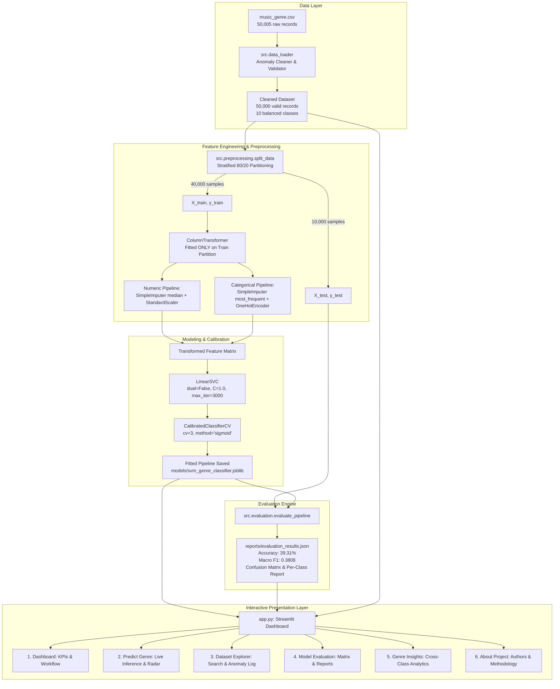
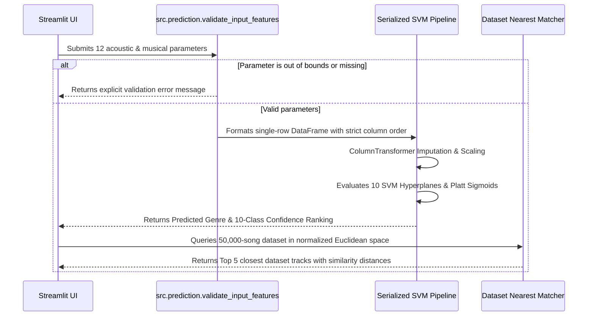

# SYSTEM ARCHITECTURE & DATA FLOW

## MUSICVERSE — Genre Intelligence Studio
### Music Genre Prediction System Using Support Vector Machine (SVM)

This document delineates the software engineering architecture, component responsibilities, and data flow of the Music Genre Prediction System.

---

## 1. High-Level System Architecture



---

## 2. Component Directory Layout

```text
d:/CS42/
├── app.py                     # Streamlit multi-page web application
├── requirements.txt           # Python dependency specifications
├── package.json               # Optional npm run dev launcher
├── run.bat                    # Windows batch execution script
├── README.md                  # Comprehensive 23-section project guide
├── .gitignore                 # Git ignore patterns for venv, cache, and models
├── data/
│   └── music_genre.csv        # Local primary dataset (50,000 clean records)
├── models/
│   ├── .gitkeep
│   ├── svm_genre_classifier.joblib  # Serialized Scikit-learn trained pipeline
│   └── model_metadata.joblib        # Hyperparameters, sample counts, timestamp
├── reports/
│   ├── .gitkeep
│   └── evaluation_results.json      # Verified metrics, classification report, CM
├── src/
│   ├── __init__.py            # Package initializer and metadata
│   ├── data_loader.py         # CSV loading, validation, anomaly cleaning
│   ├── preprocessing.py       # ColumnTransformer, split, notice generator
│   ├── model.py               # SVM pipeline construction, training, persistence
│   ├── evaluation.py          # Metric calculation, cross-validation, viva guide
│   ├── prediction.py          # Manual inference, validation, presets, song lookup
│   └── visualization.py       # Plotly charts adhering to custom dark aesthetic
├── tests/
│   ├── test_data_loader.py    # 7 unit tests for cleaning, '?', and blank rows
│   ├── test_preprocessing.py  # 5 unit tests for split, leak prevention, OHE
│   ├── test_model.py          # 7 unit tests for training, evaluation, CV, joblib
│   └── test_prediction.py     # 5 unit tests for validation, presets, prediction
└── docs/
    ├── architecture.md        # This system architecture document
    └── project_report.md      # Formal academic project report
```

---

## 3. Data Processing & Preprocessing Lifecycle

### 3.1 Raw Data Ingestion & Sanitization (`src/data_loader.py`)
1. Reads `music_genre.csv`.
2. Identifies and strips 5 entirely blank rows (`dropna(how='all')`).
3. Cleans string sentinels `'?'` in `tempo`, casting to `float64` `NaN`.
4. Converts recording duration anomalies (`<= 0`, `-1.0` ms) to `float64` `NaN`.
5. Eliminates 4 duplicate rows across all features (`drop_duplicates()`).
6. Enforces target presence: ensures `music_genre` is non-null and strips whitespace.

### 3.2 Stratified Partitioning (`src/preprocessing.py`)
- Executes an 80/20 train/test split via `train_test_split(..., stratify=y, random_state=42)`.
- Produces exactly:
  - **Training Set:** 40,000 records (4,000 per genre).
  - **Testing Set:** 10,000 records (1,000 per genre).

### 3.3 Leakage-Free Preprocessing Pipeline
- **Continuous Features (10):**
  - `acousticness`, `danceability`, `duration_ms`, `energy`, `instrumentalness`, `liveness`, `loudness`, `speechiness`, `tempo`, `valence`.
  - Processed via: `SimpleImputer(strategy='median')` followed by `StandardScaler()`.
  - Scaler statistics ($\mu, \sigma$) and imputer medians are learned **only** on the 40,000 training samples.
- **Categorical Features (2):**
  - `key` (12 pitch classes) and `mode` (`Major`/`Minor`).
  - Processed via: `SimpleImputer(strategy='most_frequent')` followed by `OneHotEncoder(handle_unknown='ignore', sparse_output=False)`.

---

## 4. Modeling & Probability Calibration (`src/model.py`)

- **Base Estimator:** `sklearn.svm.LinearSVC(dual=False, C=1.0, max_iter=3000, random_state=42)`
  - Solves the multiclass problem via One-vs-Rest (OvR).
  - Scales linearly with the number of samples, completing 40,000-sample training in ~1.3 seconds.
- **Calibration Layer:** `sklearn.calibration.CalibratedClassifierCV(estimator=base_svc, cv=3, method='sigmoid')`
  - Utilizes 3-fold internal cross-validation on the training set.
  - Fits Platt sigmoids to the margin scores, generating true probability outputs $P(y = c \mid \mathbf{x})$ summing to 1.0.

---

## 5. Inference Flow (`src/prediction.py`)



---

## 6. Execution Profiles

| Profile / Launcher | Command | Target Audience |
| :--- | :--- | :--- |
| **Streamlit Standard** | `python -m streamlit run app.py` | Cross-platform Python developers |
| **Windows Quick Launcher** | `run.bat` | Windows academic lab machines |
| **NPM Launcher** | `npm run dev` | Full-stack / Node.js development environments |
| **Test Runner** | `py -m pytest -v tests/` | Automated verification and CI |
| **CLI Retraining** | `py train_evaluate_cli.py` | Headless pipeline re-fitting |
